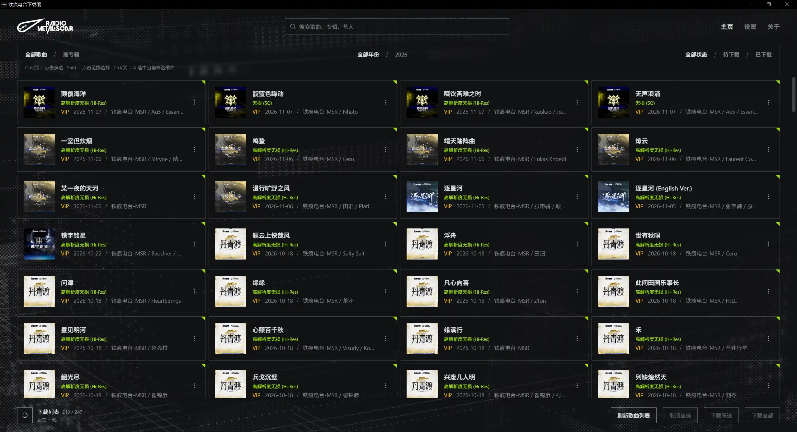
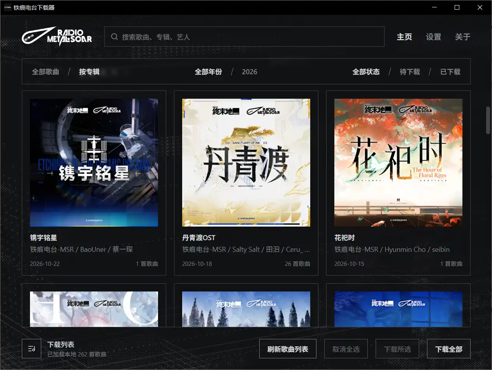
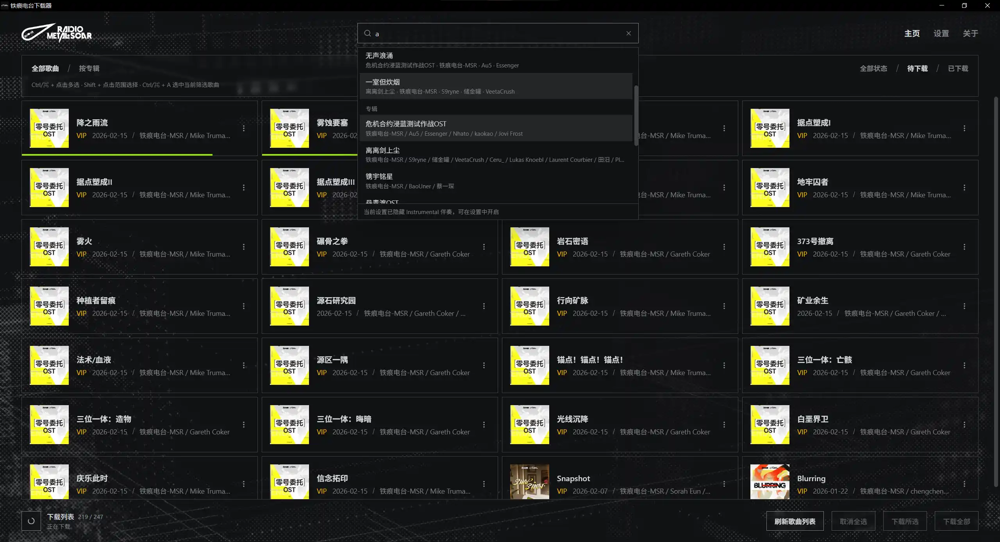
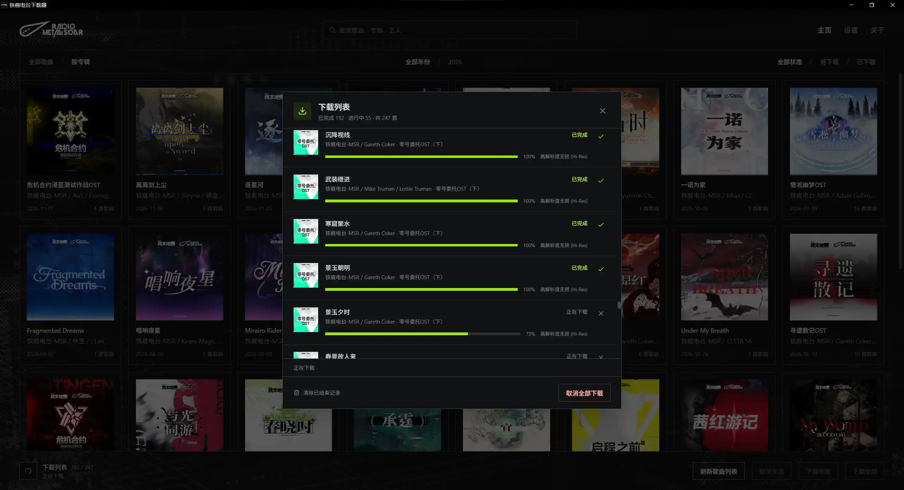

<div align="center">
<h3>Metal Scar Radio Downloader</h3>
<p>Download Metal Scar Radio albums from NetEase Cloud Music, including cover art, lyrics, and song metadata</p>

[简体中文](README.md) · [繁體中文](README.zh-TW.md) · [English](README.en.md) · [日本語](README.ja.md) · [한국어](README.ko.md)


[](https://github.com/wiseCirno/metal-scar-downloader/releases/latest)


</div>

## Features

- Browse by song or album, and search for songs, albums, and artists
- Download individual songs or multiple selections, and keep your collection up to date with incremental downloads
- Download lyrics and filter instrumental tracks
- Choose your preferred audio quality, with automatic fallback and a display of the actual quality downloaded for each
  song
- Automatically embed song metadata and album covers, with configurable artist separators, date formats, and album
  folder formats
- Works well with popular self-hosted media libraries such as Emby, Jellyfin, and Plex
- Multilingual support

## Installation

Download the latest version from the [Release](https://github.com/wiseCirno/metal-scar-downloader/releases/latest) page.

On Windows, extract the portable package and run the executable. The WebView2 runtime is required; if the application
reports a missing component at startup, download and install
it [here](https://developer.microsoft.com/zh-cn/microsoft-edge/webview2).

On macOS, open the package and drag the app to Applications. If macOS reports that the developer cannot be verified when
you first open it, allow it to open in System Settings → Privacy & Security.

On Linux, x64 AppImage, deb, and rpm packages are available. Give the AppImage executable permission before running it,
and choose the package appropriate for your distribution.

## Configuration

Before downloading songs, choose a download folder in Settings, sign in to your NetEase Cloud Music account, and install
FFmpeg.

On Windows, FFmpeg can be downloaded and installed with one click.

On macOS, install [Homebrew](https://brew.sh), then install FFmpeg with `brew install ffmpeg`.

The Linux deb package installs FFmpeg automatically; the RPM package declares a dependency on the FFmpeg executable.
AppImage users should install FFmpeg through their distribution's package manager.

After installation, click “Check Version” in the application settings. If the FFmpeg version is displayed correctly,
installation was successful.

The maximum audio quality defaults to Lossless. Depending on your account's entitlements, you can choose Hi-Res
Lossless, Lossless, Ex High, or Standard. Downloads start at the selected quality and try progressively lower levels as
needed, recording the actual quality obtained.

The album artist in audio tags is fixed to `铁痕电台-MSR`. Multiple artists are separated by a semicolon (`;`) by
default; choose a format suited to your music library in Settings.

## Usage

Click “Refresh Song List” to fetch the latest catalog. By default, the application uses
the [Metal Scar Radio](https://music.163.com/#/artist?id=122546004) catalog on NetEase Cloud Music.

The application supports individual and batch downloads. For batch downloads, the “Download Instrumentals” option
determines whether instrumental tracks are included.

Click a song card to toggle its selection. Use `Ctrl/⌘ + Click` to select multiple songs, `Shift + Click` to select a
continuous range, and `Ctrl/⌘ + A` to select all songs matching the current filters. Click “Download Selected” to
download your selection, or “Deselect All” to clear it.

Switch to “By Album” to view album covers, release dates, and track counts. Click an album to view its songs. Year and
download status filters also apply in this view.

<div align="center">

</div>

Enter keywords in the search box at the top to search for songs, albums, and artists. Selecting a song scrolls to its
position; selecting an album opens its contents; selecting an artist filters the list to songs they appear on.

<div align="center">

</div>

Click the download list icon in the lower-left corner to view each song's download progress, processing status, and
actual audio quality, or to cancel individual downloads or all download tasks.

If a download fails, the notification shows the log path. Detailed logs are saved in `.metal-scar/logs` inside the
download folder.

<div align="center">

</div>

When “Download Lyrics” is enabled, available lyrics are saved as LRC files with the same names as their corresponding
songs.

Song metadata and album covers are embedded in FLAC, MP3, and M4A files. A `cover.jpg` is also saved in the album
folder. Changes to artist separators and date formats apply to subsequent downloads.

## Frequently Asked Questions

#### 1. Why use NetEase Cloud Music?

NetEase Cloud Music has a large user base, so signing in with a NetEase account is a relatively accessible option. Its
lyrics, cover art, and songs are also among the better-quality offerings.

Some may wonder whether a platform such as Tidal would be better. Although its audio quality has a slight edge, it only
supports English, receives updates less frequently, and has no official lyrics support.

Other streaming platforms also have strict DMCA policies and encryption measures, making attempts to download their
songs for learning and discussion is inappropriate.

#### 2. Why can't I download songs?

**Metal Scar Radio does not currently have an official website.** When using its NetEase Cloud Music catalog, most songs
are VIP tracks that require a [paid-song download allowance](https://music.163.com/#/member/downinfo). Your account
therefore needs the corresponding entitlements.

#### 3. What if FFmpeg won't download?

On Windows, download FFmpeg manually from the [official website](https://ffmpeg.org/download.html), copy `ffmpeg.exe` to
`%APPDATA%\com.wisecirno.metal-scar-downloader\bin`, then click “Check Version” to confirm that it was installed
successfully.

On macOS, install it with `brew install ffmpeg`. If the download is slow, try adjusting your network connection and
retrying.

#### 4. How is a song's “Downloaded” status determined?

After a song downloads successfully, its “Downloaded” status is saved in the application's data directory.

This status is retained even if the song file is moved or deleted, allowing you to transfer music to other devices and
continue downloading incremental updates.

To download a song again, mark it as pending download in the song card menu. You can also change download statuses in
bulk in Settings.

#### 5. How can my media library distinguish multiple artists?

Choose an “Artist Separator” in Settings. The default is a semicolon, for example, `Artist A;Artist B`. Depending on
your music library, you can choose `;`, `\`, `,`, `、`, or `&`. Emby and Jellyfin only recognize `;` as the separator,
which is why it is the default.

After changing the separator, download the relevant songs again to update their audio tags.

## Roadmap

- Wait for an official website so the implementation can follow the same approach as Siren Records
- Add more useful features—perhaps the developer will come up with something after pulling out another handful of
  hair :)

## Acknowledgments

### Music Provider

[铁痕电台-MSR](https://music.163.com/#/artist?id=122546004)

### Core Project References

[nuthx/siren-downloader](https://github.com/nuthx/siren-downloader)

[NeteaseCloudMusicApiEnhanced](https://github.com/NeteaseCloudMusicApiEnhanced/api-enhanced)

### Underlying Frameworks

[FFmpeg](https://ffmpeg.org/)

[Tauri](https://tauri.app/)

## Disclaimer

This tool is intended solely for learning and technical discussion. All music copyrights belong to the original creators
and the respective rights holders. Downloaded content must not be used for commercial purposes.

The Metal Scar Radio name and related logos used in this tool are registered trademarks or copyright marks of their
lawful owners. They are used solely for identification and remain the property of the respective rights holders.

<details>
<summary>Development and Building</summary>

Built with Tauri 2, Rust, and React. Desktop builds require Rust,
the [Tauri system dependencies](https://v2.tauri.app/start/prerequisites/), and the toolchain for the target platform.

```sh
pnpm install --frozen-lockfile
pnpm run build
cargo test --manifest-path src/Cargo.toml --lib
pnpm exec tauri build --config src/tauri.conf.json
```

The first build prepares a pinned Node.js runtime and the production dependencies for the NetEase Cloud Music API,
verifying the runtime against the official Node.js SHA-256 manifest. These runtime resources are bundled with the
desktop app, extracted to the application data directory on first use, and reused by version thereafter.

To upgrade the NetEase Cloud Music API dependency, update its separate manifest and lockfile:

```sh
npm install --prefix runtime/netease-api --save-exact @neteasecloudmusicapienhanced/api@<version> --ignore-scripts
```

Then run `pnpm run build` or `pnpm dev` to prepare the runtime resources for the new version.

### Automated Builds and Releases

Pushing to `main`, opening a pull request targeting `main`, or manually running Build from the Actions page generates
packages for Windows x64, macOS Apple Silicon, and Linux x64 (AppImage, deb, and rpm). Test packages can be downloaded
from Artifacts on the corresponding Actions run page.

For an official release, first synchronize the application's version in `package.json`, `src/Cargo.toml`, and
`src/Cargo.lock`, then push the corresponding tag—for example, `v0.1.0` for the current version. The tag must match the
application version. Once all platform builds and checks pass, a GitHub Release is created automatically with the
packages and a combined `SHA256SUMS.txt` checksum file.

```sh
git tag v0.1.0
git push origin v0.1.0
```

Commit the build scripts, along with the dependency manifest and lockfile in `runtime/netease-api`, to Git. CI prepares
the generated dependencies and runtime resources automatically.

</details>
