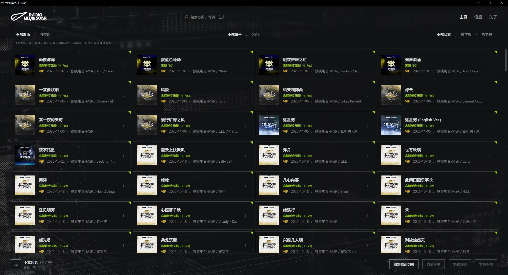
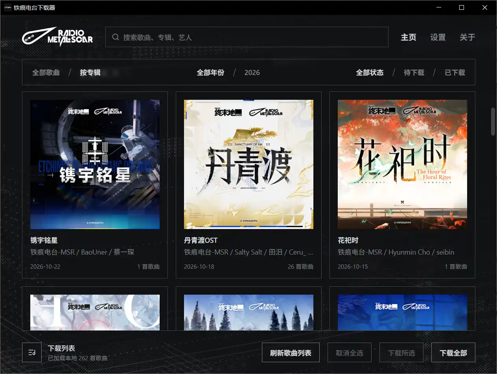
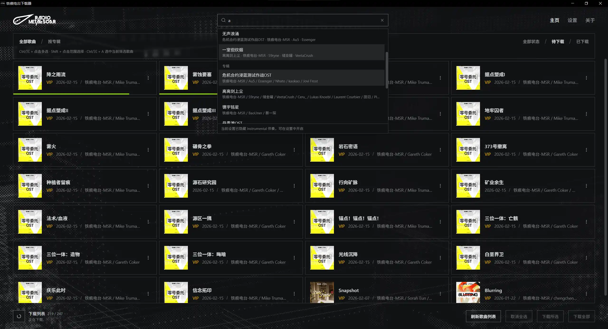
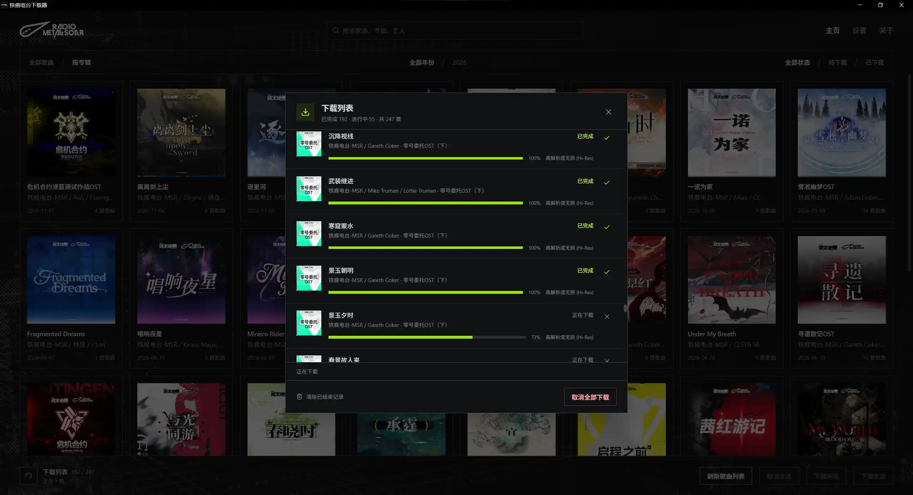

<div align="center">
<h3>鉄痕電台ダウンローダー</h3>
<p>NetEase Cloud Music から鉄痕電台の音楽アルバムをダウンロードし、ジャケット、歌詞、楽曲情報を保存</p>

[简体中文](README.md) · [繁體中文](README.zh-TW.md) · [English](README.en.md) · [日本語](README.ja.md) · [한국어](README.ko.md)


[](https://github.com/wiseCirno/metal-scar-downloader/releases/latest)


</div>

## 特長

- 曲またはアルバム単位で閲覧でき、曲・アルバム・アーティストを検索
- 1曲ダウンロード、複数選択ダウンロード、差分更新に対応
- 歌詞のダウンロード、伴奏曲の絞り込みに対応
- 希望する音質を設定でき、音質の自動フォールバックに対応。各曲で実際にダウンロードされた音質を表示
- 楽曲情報とアルバムジャケットを自動で書き込み。アーティスト区切り文字、日付形式、アルバムディレクトリ形式を選択可能
- Emby、Jellyfin、Plex など、一般的なセルフホスト型メディアライブラリに配慮
- 多言語対応

## インストール

[Release](https://github.com/wiseCirno/metal-scar-downloader/releases/latest) ページから最新版をダウンロードしてください。

Windows ポータブル版は展開後、そのまま実行ファイルを起動できます。WebView2
ランタイムが必要です。コンポーネントが見つからないというメッセージが表示された場合は、[こちら](https://developer.microsoft.com/zh-cn/microsoft-edge/webview2)
からダウンロードしてインストールしてください。

macOS
では、アプリを「アプリケーション」フォルダにドラッグしてください。初回起動時に開発元を検証できないという警告が表示された場合は、「システム設定 →
プライバシーとセキュリティ」で起動を許可してください。

Linux 版は x64 AppImage、deb、rpm を提供しています。AppImage は実行権限を付与してから起動してください。お使いのディストリビューションに合った形式を選択してください。

## 設定

曲をダウンロードする前に、設定で保存先を選択し、NetEase Cloud Music アカウントにログインして、FFmpeg をインストールしてください。

Windows では FFmpeg をワンクリックでダウンロード・インストールできます。

macOS では [Homebrew](https://brew.sh) をインストールし、`brew install ffmpeg` で FFmpeg をインストールしてください。

Linux の deb は FFmpeg を自動でインストールします。RPM は FFmpeg 実行ファイルへの依存関係を宣言します。AppImage
を使う場合は、ディストリビューションのパッケージマネージャーから FFmpeg をインストールしてください。

インストール後、アプリの設定で「バージョンを確認」をクリックし、FFmpeg のバージョンが正しく表示されれば完了です。

最高音質はデフォルトでロスレスです。アカウントの権限に応じて、ハイレゾロスレス、ロスレス、高音質、標準から選択できます。ダウンロード時は選択した音質から順に試し、実際に取得できた音質を保存します。

音声タグのアルバムアーティストは `铁痕电台-MSR` 固定です。複数アーティストの区切りにはデフォルトでセミコロン `;`
を使用します。設定でお使いの音楽ライブラリに合った形式を選択できます。

## 使い方

「曲リストを更新」をクリックすると最新の曲目を取得します。デフォルトでは、NetEase Cloud Music
の[鉄痕電台](https://music.163.com/#/artist?id=122546004)を読み込みます。

1曲ずつ、または複数曲をまとめてダウンロードできます。まとめてダウンロードする際、伴奏曲を含めるかどうかは「伴奏をダウンロード」オプションで決まります。

曲カードをクリックすると選択状態を切り替えられます。`Ctrl/⌘ + クリック` で複数選択、`Shift + クリック` で範囲選択できます。
`Ctrl/⌘ + A` で現在の絞り込み結果をすべて選択できます。選択後に「選択した曲をダウンロード」をクリックしてください。「すべての選択を解除」をクリックすると選択を解除できます。

「アルバム別」に切り替えると、ジャケット、リリース日、曲数を確認できます。アルバムをクリックすると収録曲を表示します。年やダウンロード状況による絞り込みも同様に利用できます。

<div align="center">

</div>

上部の検索欄にキーワードを入力すると、曲・アルバム・アーティストを検索できます。曲を選択すると該当位置へスクロールし、アルバムを選択すると収録内容を表示します。アーティストを選択すると、そのアーティストが参加している曲に絞り込みます。

<div align="center">

</div>

左下のダウンロードリストアイコンをクリックすると、曲ごとの進捗、処理状況、実際の音質を確認できます。個別またはすべてのダウンロードをキャンセルできます。

ダウンロードに失敗すると、メッセージにログの保存先が表示されます。詳細はダウンロード先の `.metal-scar/logs` に保存されます。

<div align="center">

</div>

「歌詞をダウンロード」を有効にすると、利用可能な歌詞を曲と同じ名前の LRC ファイルとして保存します。

FLAC、MP3、M4A ファイルには楽曲情報とアルバムジャケットを書き込みます。アルバムフォルダには `cover.jpg`
も保存します。アーティスト区切り文字と日付形式の設定は、以降のダウンロードに反映されます。

## よくある質問

#### 1. なぜ NetEase Cloud Music を選んだのですか？

NetEase Cloud Music は現在ユーザーが多く、アカウントを使う方法は比較的受け入れられやすいと考えています。また、歌詞、ジャケット、楽曲の品質も比較的良好です。
Tidal は音質でわずかに優れるものの、英語にしか対応しておらず、更新も遅く、公式の歌詞サポートもありません。
そのほかのストリーミングサービスには厳格な DMCA ポリシーや暗号化対策があります。学習・情報交換目的であっても、そこで配信される曲をダウンロードしようとするのは適切ではありません。

#### 2. 曲をダウンロードできないのはなぜですか？

**鉄痕電台には現在、公式サイトがありません。** NetEase Cloud Music のカタログを利用していますが、鉄痕電台の曲の大半は VIP
対象です。ダウンロードするには、アカウントに対応する[有料曲のダウンロード枠](https://music.163.com/#/member/downinfo)
が必要です。

#### 3. FFmpeg をダウンロードできない場合

Windows では[公式サイト](https://ffmpeg.org/download.html)から FFmpeg を手動でダウンロードし、`ffmpeg.exe` を
`%APPDATA%\com.wisecirno.metal-scar-downloader\bin` にコピーしてください。その後、「バージョンを確認」をクリックしてインストール結果を確認します。

macOS では `brew install ffmpeg` でインストールできます。ダウンロードが遅い場合は、ネットワーク環境を変更して再度お試しください。

#### 4. 曲の「ダウンロード済み」状態はどのように決まりますか？

曲のダウンロードが成功すると、「ダウンロード済み」の状態がアプリのデータディレクトリに保存されます。

曲ファイルを移動または削除しても、アプリはダウンロード状態を保持します。音楽を別のデバイスに移して、差分更新を続けられるようにするためです。

再ダウンロードする場合は、曲カードのメニューから「未ダウンロード」に変更するか、設定でダウンロード状態を一括変更してください。

#### 5. 複数アーティストをメディアライブラリで区別するには？

設定で「アーティスト区切り文字」を選択します。デフォルトはセミコロンで、例は `アーティストA;アーティストB` です。音楽ライブラリに合わせて
`;`、`\`、`,`、`、`、`&` から選択できます。
Emby、Jellyfin は `;` 区切りのみを認識するため、デフォルトもセミコロンです。

変更後、該当する曲を再ダウンロードすると、ファイル内の音声タグが更新されます。

## 今後の予定

- 公式サイトの公開を待ち、塞壬唱片の実装方式に合わせる
- 便利な機能を追加する。開発者が頭をもう一度かきむしれば、何か思いつくかもしれません（

## 謝辞

### 音源提供

[鉄痕電台-MSR](https://music.163.com/#/artist?id=122546004)

### 参考にした主要プロジェクト

[nuthx/siren-downloader](https://github.com/nuthx/siren-downloader)

[NeteaseCloudMusicApiEnhanced](https://github.com/NeteaseCloudMusicApiEnhanced/api-enhanced)

### 基盤フレームワーク

[FFmpeg](https://ffmpeg.org/)

[Tauri](https://tauri.app/)

## 免責事項

本ツールは学習および技術交流のみを目的としています。すべての音楽の著作権は原作者および各権利者に帰属します。ダウンロードしたコンテンツを商用利用することは禁止されています。

本ツールで使用している「鉄痕電台」および関連ロゴは、正当な権利者が所有する登録商標または著作権表示であり、識別目的でのみ使用しています。これらは各権利者に帰属します。

<details>
<summary>開発とビルド</summary>

Tauri 2、Rust、React を使用しています。デスクトップ版のビルドには
Rust、[Tauri のシステム依存関係](https://v2.tauri.app/start/prerequisites/)、および対象プラットフォームのツールチェーンが必要です。

```sh
pnpm install --frozen-lockfile
pnpm run build
cargo test --manifest-path src/Cargo.toml --lib
pnpm exec tauri build --config src/tauri.conf.json
```

初回ビルド時に、固定バージョンの Node.js ランタイムと NetEase Cloud Music API の本番依存パッケージを準備し、Node.js 公式の
SHA-256 マニフェストでランタイムを検証します。実行リソースはデスクトップアプリに同梱され、初回使用時にアプリのデータディレクトリへ展開されます。以降はバージョンごとに再利用されます。

NetEase Cloud Music API の依存バージョンを更新する場合は、専用のマニフェストとロックファイルを更新してください。

```sh
npm install --prefix runtime/netease-api --save-exact @neteasecloudmusicapienhanced/api@<version> --ignore-scripts
```

その後、`pnpm run build` または `pnpm dev` を実行すると、新しいバージョンに合わせて実行リソースが準備されます。

### 自動ビルドとリリース

`main` への push、`main` を対象とする PR、または Actions ページから Build を手動実行すると、Windows x64、macOS Apple
Silicon、Linux x64（AppImage、deb、rpm）のパッケージが生成されます。テスト用パッケージは該当する Actions 実行ページの
Artifacts からダウンロードできます。

正式リリースでは、`package.json`、`src/Cargo.toml`、`src/Cargo.lock` に記載されたアプリのバージョンを一致させてから、対応するタグを
push してください。現在のバージョンなら `v0.1.2` です。タグはアプリのバージョンと一致する必要があります。すべてのプラットフォームのビルドとチェックに成功すると、GitHub
Release が自動作成され、パッケージと統合版の `SHA256SUMS.txt` がアップロードされます。

```sh
git tag v0.1.2
git push origin v0.1.2
```

ビルドスクリプトと `runtime/netease-api` の依存マニフェストおよびロックファイルは Git にコミットしてください。依存パッケージと実行リソースは
CI が自動で準備します。

</details>
