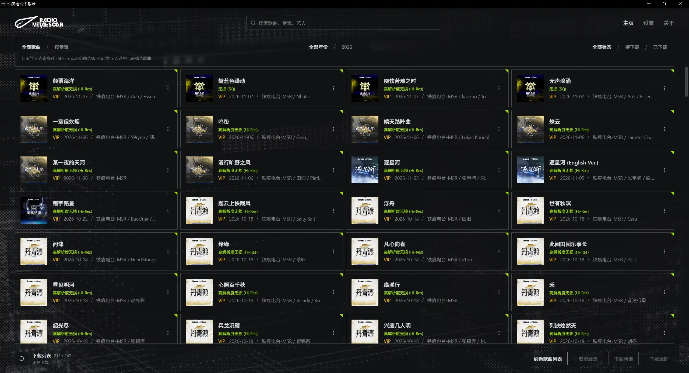
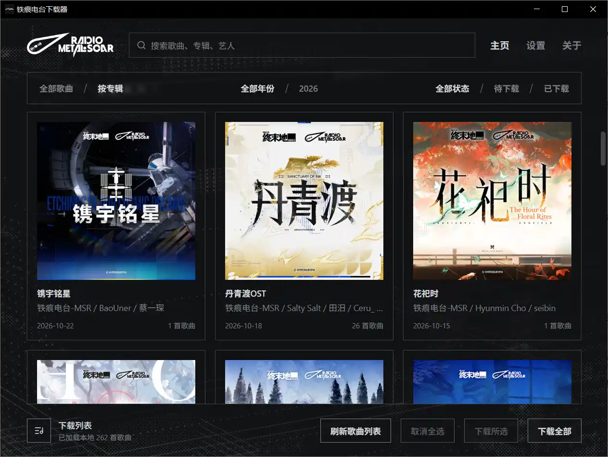
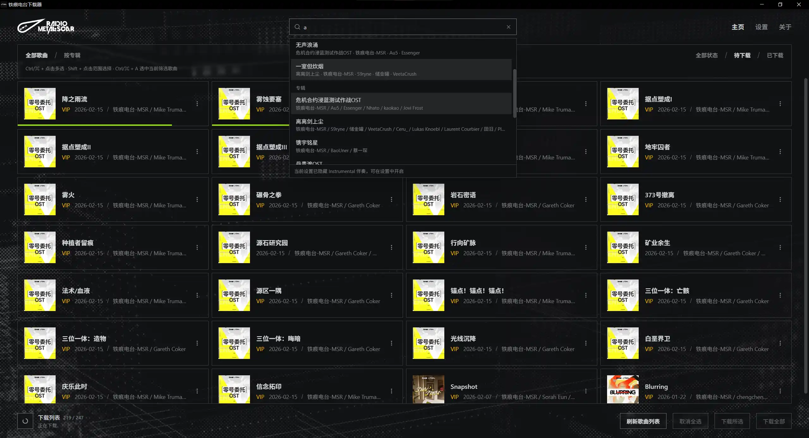
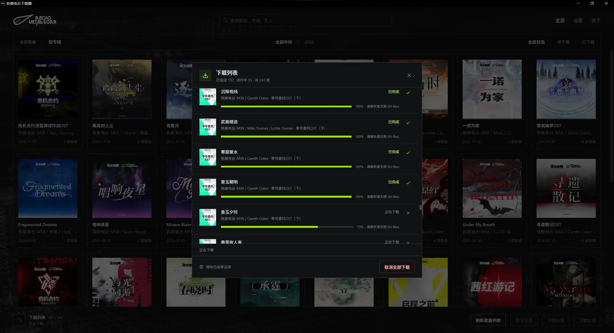

<div align="center">
<h3>철흔 라디오 다운로더</h3>
<p>NetEase Cloud Music에서 철흔 라디오의 음악 앨범을 다운로드하고 커버, 가사 및 곡 정보를 저장합니다</p>

[简体中文](README.md) · [繁體中文](README.zh-TW.md) · [English](README.en.md) · [日本語](README.ja.md) · [한국어](README.ko.md)


[](https://github.com/wiseCirno/metal-scar-downloader/releases/latest)


</div>

## 주요 기능

- 곡 또는 앨범별 탐색, 곡·앨범·아티스트 검색 지원
- 단일 곡 다운로드, 여러 곡 선택 다운로드 및 증분 업데이트 지원
- 가사 다운로드 및 반주 곡 필터링 지원
- 원하는 음질 설정, 자동 음질 하향 조정 및 곡별 실제 다운로드 음질 표시
- 곡 정보와 앨범 커버 자동 기록, 아티스트 구분자·날짜 형식·앨범 폴더 형식 설정 지원
- 주요 자체 호스팅 미디어 라이브러리 (Emby, Jellyfin, Plex 등)에 적합
- 다국어 지원

## 설치

[Release](https://github.com/wiseCirno/metal-scar-downloader/releases/latest) 페이지에서 최신 버전을 다운로드하세요.

Windows 포터블 버전은 압축을 푼 뒤 실행 파일을 바로 실행할 수 있습니다. 단, WebView2 런타임이 필요합니다. 실행 시 구성 요소가 없다는 메시지가
표시되면 [여기](https://developer.microsoft.com/zh-cn/microsoft-edge/webview2)에서 다운로드하여 설치하세요.

macOS에서는 앱을 연 뒤 응용 프로그램 폴더로 드래그하면 됩니다. 처음 실행할 때 개발자를 확인할 수 없다는 메시지가 표시되면 “시스템 설정 → 개인정보 보호 및 보안”에서 실행을 허용하세요.

Linux용 x64 AppImage, deb 및 rpm을 제공합니다. AppImage에는 실행 권한을 추가한 뒤 실행하고, 배포판에 맞는 패키지를 선택하세요.

## 설정

곡을 다운로드하기 전에 설정에서 다운로드 경로를 선택하고 NetEase Cloud Music 계정에 로그인한 다음 FFmpeg 도구를 설치하세요.

Windows에서는 FFmpeg를 한 번의 클릭으로 다운로드하고 설치할 수 있습니다.

macOS에서는 [Homebrew](https://brew.sh)를 설치한 다음 `brew install ffmpeg`로 FFmpeg 도구를 설치해야 합니다.

Linux deb는 FFmpeg를 자동으로 설치합니다. RPM은 FFmpeg 실행 파일 의존성을 선언합니다. AppImage 사용자는 배포판의 패키지 관리자를 통해 FFmpeg를 설치하세요.

설치가 완료되면 앱 설정에서 “버전 확인”을 클릭했을 때 FFmpeg 버전이 표시되는지 확인하세요.

기본 최고 음질은 무손실입니다. 계정 권한에 따라 Hi-Res 무손실, 무손실, 매우 높음 또는 표준을 선택할 수 있습니다. 다운로드는 선택한 음질부터 단계적으로 시도하며 실제로 얻은 음질을 저장합니다.

오디오 태그의 앨범 아티스트는 `铁痕电台-MSR`로 고정됩니다. 여러 아티스트는 기본적으로 세미콜론 `;`으로 구분하며, 설정에서 사용하는 미디어 라이브러리에 맞는 형식을 선택할 수 있습니다.

## 사용 안내

“곡 목록 새로고침”을 클릭하면 최신 곡 목록을 가져옵니다. 기본 목록은 NetEase Cloud Music의 [철흔 라디오](https://music.163.com/#/artist?id=122546004)입니다.

곡 하나씩 다운로드하거나 여러 곡을 일괄 다운로드할 수 있습니다. 일괄 다운로드에 반주 곡을 포함할지는 “반주 다운로드” 옵션으로 결정합니다.

곡 카드를 클릭하면 선택 상태를 전환할 수 있습니다. `Ctrl/⌘ + 클릭`으로 여러 곡을 선택하고, `Shift + 클릭`으로 연속된 범위를 선택할 수 있습니다. `Ctrl/⌘ + A`를 누르면 현재 필터에
표시된 모든 곡을 선택합니다. 선택 후 “선택 항목 다운로드”를 클릭하세요. “전체 선택 해제”를 클릭하면 선택을 모두 해제합니다.

“앨범별” 보기로 전환하면 앨범 커버, 발매일 및 곡 수를 확인할 수 있습니다. 앨범을 클릭하면 수록곡을 볼 수 있으며 연도 및 다운로드 상태 필터도 사용할 수 있습니다.

<div align="center">

</div>

상단 검색창에 키워드를 입력하면 곡, 앨범 및 아티스트를 검색할 수 있습니다. 곡을 선택하면 해당 위치로 스크롤되고, 앨범을 선택하면 앨범 내용을 볼 수 있으며, 아티스트를 선택하면 해당 아티스트가 참여한 곡으로
필터링됩니다.

<div align="center">

</div>

왼쪽 아래의 다운로드 목록 아이콘을 클릭하면 곡별 다운로드 진행률, 처리 상태 및 실제 음질을 확인하고 개별 또는 전체 다운로드 작업을 취소할 수 있습니다.

다운로드가 실패하면 알림에 로그 경로가 표시됩니다. 자세한 정보는 다운로드 폴더의 `.metal-scar/logs`에 저장됩니다.

<div align="center">

</div>

“가사 다운로드”를 켜면 제공되는 가사를 곡과 같은 이름의 LRC 파일로 저장합니다.

FLAC, MP3 및 M4A 파일에는 곡 정보와 앨범 커버가 기록됩니다. 앨범 폴더에는 `cover.jpg`도 저장됩니다. 아티스트 구분자와 날짜 형식 설정은 이후 다운로드부터 적용됩니다.

## 자주 묻는 질문

#### 1. 왜 NetEase Cloud Music을 선택했나요?

현재 NetEase Cloud Music의 사용자층이 넓고, 계정 로그인을 이용하는 방식이 비교적 쉽게 받아들여질 수 있기 때문입니다. 가사와 커버를 지원하고 곡 품질도 좋은 편입니다.
Tidal은 음질에서 약간 앞서지만, 영어만 지원하고 업데이트가 느리며 공식 가사 지원도 없습니다.
그 밖의 스트리밍 플랫폼은 엄격한 DMCA 정책과 암호화 수단을 적용하고 있습니다. 학습 및 기술 교류를 목적으로 하더라도 해당 플랫폼의 곡을 다운로드하는 것은 적절하지 않습니다.

#### 2. 곡을 다운로드할 수 없는 이유는 무엇인가요?

**철흔 라디오에는 현재 공식 웹사이트가 없습니다.** NetEase Cloud Music 곡 목록을 이용할 경우 철흔 라디오 곡 대부분이 VIP 곡이므로 다운로드하려면
일정한 [유료 곡 다운로드 한도](https://music.163.com/#/member/downinfo)가 필요합니다. 따라서 계정에 해당 권한이 있어야 합니다.

#### 3. FFmpeg를 다운로드할 수 없습니다

Windows에서는 [공식 사이트](https://ffmpeg.org/download.html)에서 FFmpeg를 직접 다운로드한 다음 `ffmpeg.exe`를
`%APPDATA%\com.wisecirno.metal-scar-downloader\bin` 폴더에 복사하고 “버전 확인”을 클릭해 설치를 확인하세요.

macOS에서는 `brew install ffmpeg`로 설치할 수 있습니다. 다운로드 속도가 느리면 네트워크 환경을 변경한 뒤 다시 시도하세요.

#### 4. 곡의 “다운로드 완료” 상태는 어떻게 결정되나요?

곡 다운로드에 성공하면 “다운로드 완료” 상태가 앱 데이터 폴더에 저장됩니다.

곡 파일을 이동하거나 삭제해도 앱은 다운로드 상태를 유지합니다. 따라서 음악을 다른 기기로 옮긴 뒤에도 증분 업데이트를 계속할 수 있습니다.

다시 다운로드해야 한다면 곡 카드 메뉴에서 대기 상태로 표시하거나 설정에서 다운로드 상태를 일괄 변경할 수 있습니다.

#### 5. 미디어 라이브러리에서 여러 아티스트를 구분하려면 어떻게 하나요?

설정에서 “아티스트 구분자”를 선택하세요. 기본값은 세미콜론이며 예를 들면 `아티스트A;아티스트B`와 같습니다. 사용하는 미디어 라이브러리에 따라 `;`, `\`, `,`, `、` 또는 `&`를 선택할 수 있습니다.
Emby와 Jellyfin은 `;` 구분자만 인식하므로 기본값을 세미콜론으로 설정했습니다.

변경 사항을 오디오 태그에 반영하려면 해당 곡을 다시 다운로드하세요.

## 향후 계획

- 공식 웹사이트가 생기기를 기다려 사이렌 레코드의 구현 방식과 맞추기
- 실용적인 기능을 더 추가하기. 개발자가 머리카락을 한 움큼 뽑고 나면 아이디어가 떠오를지도 모릅니다.（

## 감사의 말

### 음원 제공자

[철흔 라디오-MSR](https://music.163.com/#/artist?id=122546004)

### 참고한 핵심 프로젝트

[nuthx/siren-downloader](https://github.com/nuthx/siren-downloader)

[NeteaseCloudMusicApiEnhanced](https://github.com/NeteaseCloudMusicApiEnhanced/api-enhanced)

### 기반 프레임워크

[FFmpeg](https://ffmpeg.org/)

[Tauri](https://tauri.app/)

## 면책 조항

이 도구는 학습 및 기술 교류 목적으로만 제공됩니다. 모든 음악의 저작권은 원작자와 관련 권리자에게 있으며, 다운로드한 콘텐츠를 상업적 용도로 사용해서는 안 됩니다.

이 도구에서 사용하는 철흔 라디오 및 관련 로고는 정당한 소유자의 등록 상표 또는 저작권 표시이며, 식별 목적으로만 사용됩니다. 해당 권리는 관련 권리자에게 있습니다.

<details>
<summary>개발 및 빌드</summary>

Tauri 2, Rust 및 React를 기반으로 합니다. 데스크톱 빌드에는 Rust, [Tauri 시스템 종속성](https://v2.tauri.app/start/prerequisites/) 및 대상 플랫폼 도구
모음이 필요합니다.

```sh
pnpm install --frozen-lockfile
pnpm run build
cargo test --manifest-path src/Cargo.toml --lib
pnpm exec tauri build --config src/tauri.conf.json
```

첫 빌드에서는 고정 버전의 Node.js 런타임과 NetEase Cloud Music API 프로덕션 종속성을 준비하고, Node.js 공식 SHA-256
목록으로 런타임을 검증합니다. 런타임 리소스는 데스크톱 앱에 포함되며, 처음 사용할 때 앱 데이터 폴더에 압축 해제된 후 버전별로 재사용됩니다.

NetEase Cloud Music API 종속성을 업그레이드할 때는 별도의 매니페스트와 잠금 파일을 업데이트하세요.

```sh
npm install --prefix runtime/netease-api --save-exact @neteasecloudmusicapienhanced/api@<version> --ignore-scripts
```

그런 다음 `pnpm run build` 또는 `pnpm dev`를 실행하면 새 버전에 맞는 런타임 리소스가 준비됩니다.

### 자동 빌드 및 배포

`main`에 커밋하거나 `main` 대상 PR을 열거나 Actions 페이지에서 Build를 수동 실행하면 Windows x64, macOS Apple Silicon 및 Linux x64 (AppImage,
deb, rpm) 설치 패키지가 생성됩니다. 테스트 패키지는 해당 Actions 실행 페이지의 Artifacts에서 다운로드할 수 있습니다.

정식 배포 시에는 먼저 `package.json`, `src/Cargo.toml` 및 `src/Cargo.lock`에 있는 앱 버전을 일치시킨 다음 해당 태그를 푸시하세요. 예를 들어 현재 버전은 `v0.1.1`
입니다. 태그는 앱 버전과 일치해야 합니다. 모든 플랫폼의 빌드 및 검사가 통과하면 GitHub Release가 자동으로 생성되고 설치 패키지와 통합 `SHA256SUMS.txt` 체크섬 파일이 업로드됩니다.

```sh
git tag v0.1.1
git push origin v0.1.1
```

빌드 스크립트와 `runtime/netease-api`의 종속성 매니페스트 및 잠금 파일은 Git에 커밋해야 합니다. 종속성과 런타임 리소스는 CI에서 자동으로 준비됩니다.

</details>
