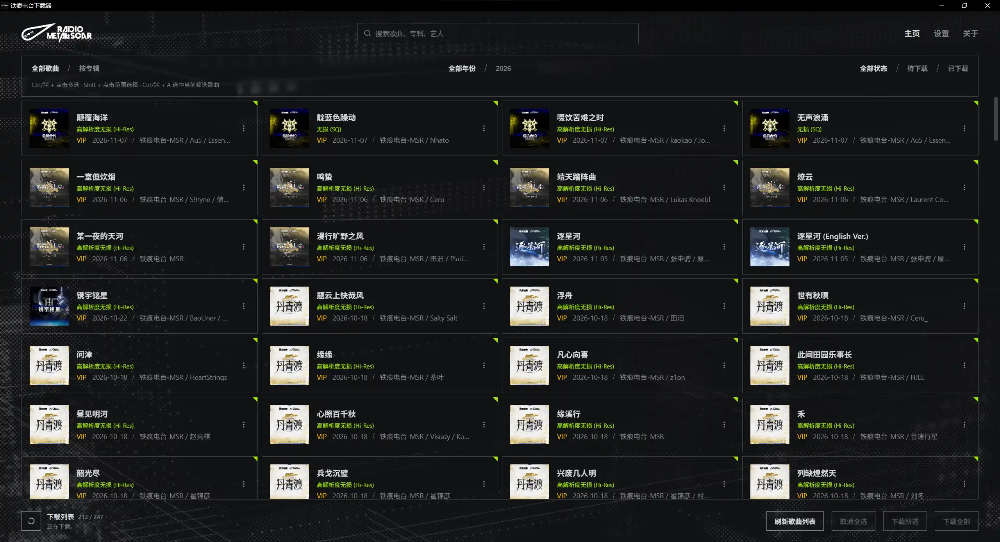
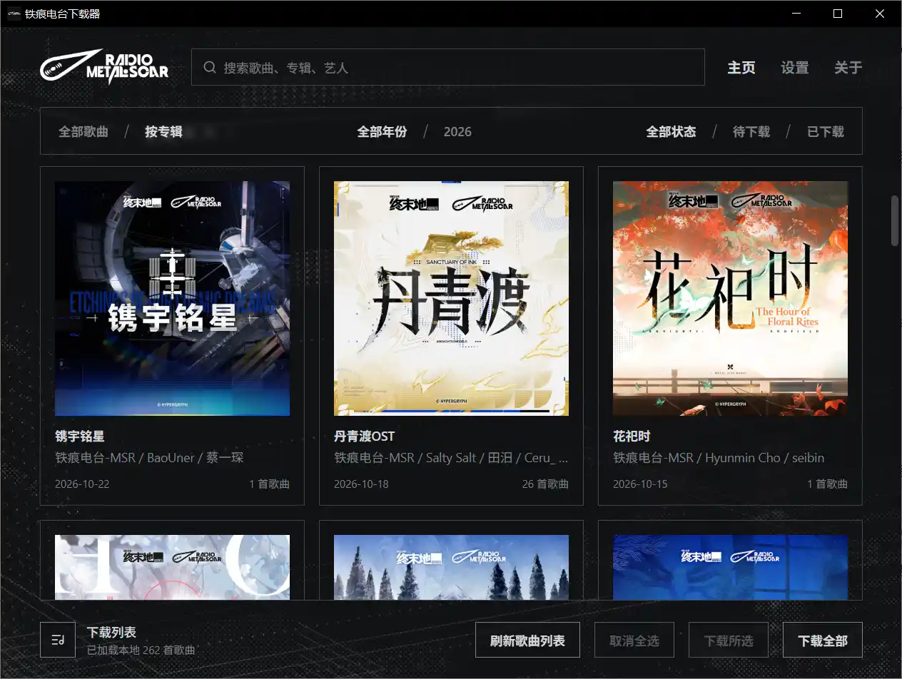
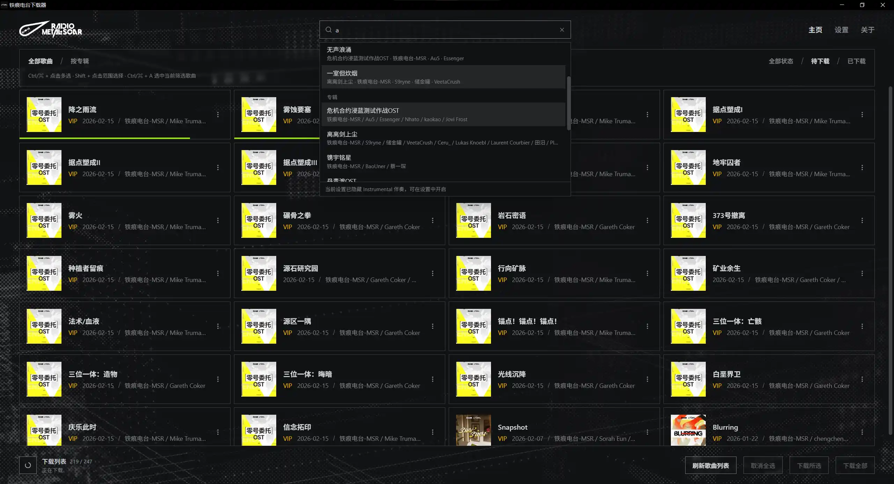
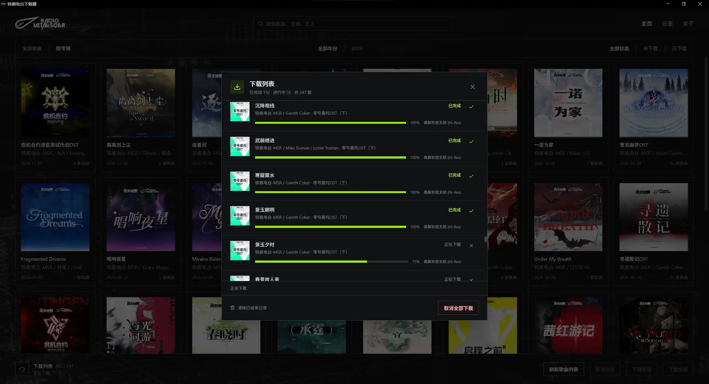

<div align="center">
<h3>铁痕电台下载器</h3>
<p>从网易云音乐下载铁痕电台的音乐专辑，保存封面、歌词与歌曲信息</p>

[简体中文](README.md) · [繁體中文](README.zh-TW.md) · [English](README.en.md) · [日本語](README.ja.md) · [한국어](README.ko.md)


[](https://github.com/wiseCirno/metal-scar-downloader/releases/latest)


</div>

## 特色

- 按歌曲或专辑浏览，支持搜索歌曲、专辑和艺人
- 支持单曲下载、多选下载和增量更新
- 支持下载歌词、伴奏筛选
- 可自定义期望音质，支持自动回退并显示每首歌曲实际下载音质
- 自动写入歌曲信息与专辑封面，支持选择艺人分隔符、日期格式和专辑目录格式
- 对主流自建媒体库友好（Emby, Jellyfin, Plex 等）
- 多语言支持

## 安装

在 [Release](https://github.com/wiseCirno/metal-scar-downloader/releases/latest) 页面下载最新版本

Windows 便携版解压后可以直接运行可执行文件，但需要 WebView2
运行时，启动时若提示缺少组件，可在 [这里](https://developer.microsoft.com/zh-cn/microsoft-edge/webview2) 下载安装

macOS 打开后将应用拖入“应用程序”即可。首次打开若提示开发者未验证，可在“系统设置 → 隐私与安全性”中允许打开

Linux 提供 x64 AppImage、deb 和 rpm，AppImage 添加执行权限后即可运行，请根据自己的发行版自行选择

## 配置

下载歌曲前，在设置中选择下载路径、登录网易云音乐账号，并安装 FFmpeg 工具

Windows 支持一键下载安装 FFmpeg

macOS 需要安装 [Homebrew](https://brew.sh)，并通过 `brew install ffmpeg` 安装 FFmpeg 工具

Linux deb 会自动安装 FFmpeg；RPM 会声明 FFmpeg 可执行文件依赖。AppImage 用户请通过发行版的软件包管理器安装 FFmpeg

安装完成后，在程序设置中点击“查看版本”可正确显示 FFmpeg 版本，则表示安装成功

最高音质默认为无损，可根据账号权限选择 高解析度无损、无损、极高或标准；下载时会从所选音质开始逐级尝试，并保存实际取得的音质

音频标签中的专辑艺人固定为 `铁痕电台-MSR`，多位艺人默认用分号 `;` 分隔，可在设置中选择适合自己音乐媒体库的格式

## 使用说明

点击“刷新歌曲列表”可获取最新曲库，默认读取网易云音乐中的 [铁痕电台](https://music.163.com/#/artist?id=122546004)

程序支持单曲下载和批量下载，批量下载时会根据“下载伴奏”选项决定是否包含伴奏歌曲

点击歌曲卡片可切换选择状态；`Ctrl/⌘ + 点击` 可多选，`Shift + 点击` 可选择连续范围，`Ctrl/⌘ + A`
可选中当前筛选下的全部歌曲。选好后点击“下载所选”，点击“取消全选”可清空选择

切换到“按专辑”可查看专辑封面、发行日期与歌曲数量，点击专辑可查看其中歌曲；年份和下载状态筛选同样适用

<div align="center">

</div>

在顶部搜索框输入关键词，可搜索歌曲、专辑和艺人。选择歌曲会滚动定位到对应位置，选择专辑可查看专辑内容，选择艺人可筛选其参与的歌曲

<div align="center">

</div>

点击左下角的下载列表图标，可逐首查看下载进度、处理状态与实际音质，并取消单首或全部下载任务

下载失败时，提示中会显示日志路径，详细信息保存在下载目录的 `.metal-scar/logs` 中

<div align="center">

</div>

开启“下载歌词”后，会将可用歌词保存为与歌曲同名的 LRC 文件

FLAC、MP3 和 M4A 文件会写入歌曲信息与专辑封面，专辑目录同时保存 `cover.jpg`。艺人分隔符和日期格式设置在后续下载时生效

## 常见问题

#### 1. 为什么选择网易云

目前网易云用户群体比较多，使用网易云账号登陆是相对比较容易接受的方式，且歌词，封面及歌曲的质量是比较好的一档。
有的人可能会想 Tidal 这样的平台会不会更好，我认为除了音质上的微弱优势，其他各方面都会相对麻烦，
首先是只有英文支持，而且更新速度是落后的，没有官方的歌词支持，其次需要一定网络环境才能下载，这会大大提高门槛，得不偿失。
此外其他的流媒体平台有严格的DMCA政策与加密手段，作为学习交流用途去尝试下载上面的歌曲是不合适的。

#### 2. 为什么没法下载歌曲

**铁痕电台目前并没有官网**，而采用网易云曲库时，由于铁痕电台大部分歌曲均为 VIP
歌曲，需要一定的[付费歌曲额度](https://music.163.com/#/member/downinfo)才能下载，因此需要账号拥有对应权益

#### 3. 无法下载 FFmpeg

Windows 可从 [官网](https://ffmpeg.org/download.html) 手动下载 FFmpeg，将 `ffmpeg.exe` 复制到
`%APPDATA%\com.wisecirno.metal-scar-downloader\bin` 目录下，再点击“查看版本”确认安装结果

macOS 可通过 `brew install ffmpeg` 安装，下载速度较慢时可调整网络环境后重试

#### 4. 如何定义歌曲的“已下载”状态

歌曲下载成功后，会将“已下载”状态保存到应用数据目录中

歌曲文件移动或删除后，程序仍保留下载状态，方便将音乐转移到其他设备，并继续增量更新

需要重新下载时，可在歌曲卡片菜单中将其标记为待下载，也可在设置中批量修改下载状态

#### 5. 如何让媒体库区分多位艺人

在设置中选择“艺人分隔符”，默认使用分号，例如 `艺人A;艺人B`。可根据自己的音乐媒体库选择 `;`、`\`、`,`、`、`或 `&`。
Emby, Jellyfin 就只认 `;` 分隔，所以默认选项就是这个了

修改后重新下载对应歌曲，即可更新文件中的音频标签

## 后续计划

- 等待官方网站，这样就能和塞壬唱片的实现方式对齐
- 增添一些实用功能，让开发者薅掉一把头发可能就有思路了（

## 致谢

### 唱片提供者

[铁痕电台-MSR](https://music.163.com/#/artist?id=122546004)

### 核心项目参考

[nuthx/siren-downloader](https://github.com/nuthx/siren-downloader)

[NeteaseCloudMusicApiEnhanced](https://github.com/NeteaseCloudMusicApiEnhanced/api-enhanced)

### 基础框架

[FFmpeg](https://ffmpeg.org/)

[Tauri](https://tauri.app/)

## 免责声明

本工具仅用于学习与技术交流，所有音乐版权均归原作者及相关版权方所有，任何下载内容均不得用于商业用途。

本工具中使用的铁痕电台及相关LOGO均为其合法拥有者的注册商标或版权标识，仅用于标识目的，归相关版权方所有

<details>
<summary>开发与构建</summary>

基于 Tauri 2、Rust 和 React。桌面构建需要 Rust、[Tauri 系统依赖](https://v2.tauri.app/start/prerequisites/) 和目标平台工具链

```sh
pnpm install --frozen-lockfile
pnpm run build
cargo test --manifest-path src/Cargo.toml --lib
pnpm exec tauri build --config src/tauri.conf.json
```

首次构建会准备固定版本的 Node.js 运行时和网易云音乐 API 生产依赖，并按 Node.js 官方 SHA-256
清单校验运行时。运行资源随桌面应用打包，首次使用时释放到应用数据目录，之后按版本复用

升级网易云音乐 API 依赖时，更新独立清单和锁文件：

```sh
npm install --prefix runtime/netease-api --save-exact @neteasecloudmusicapienhanced/api@<version> --ignore-scripts
```

之后执行 `pnpm run build` 或 `pnpm dev`，即可按新版本准备运行资源

### 自动构建与发行

提交到 `main`、向 `main` 发起 PR，或在 Actions 页面手动运行 Build，都会生成 Windows x64、macOS Apple Silicon 和 Linux
x64（AppImage、deb、rpm）安装包。测试包可在对应 Actions 运行页面的 Artifacts 中下载

正式发行时，先统一 `package.json`、`src/Cargo.toml` 和 `src/Cargo.lock` 中本应用的版本，再推送对应标签，例如当前版本使用
`v0.1.0`。标签必须与应用版本一致；所有平台构建及检查通过后，会自动创建 GitHub Release 并上传安装包和统一的 `SHA256SUMS.txt`
校验文件

```sh
git tag v0.1.0
git push origin v0.1.0
```

构建脚本与 `runtime/netease-api` 中的依赖清单、锁文件均需提交到 Git，生成的依赖和运行资源由 CI 自动准备

</details>
