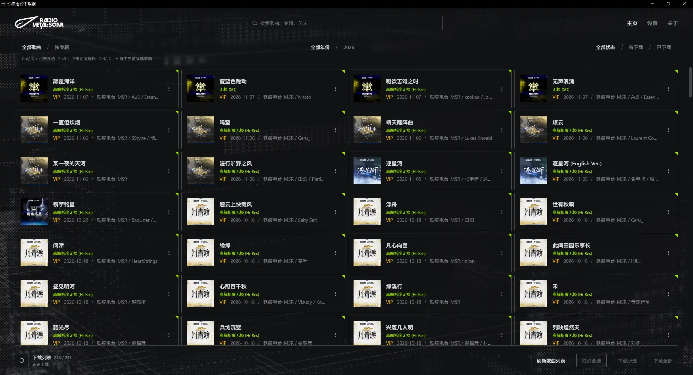
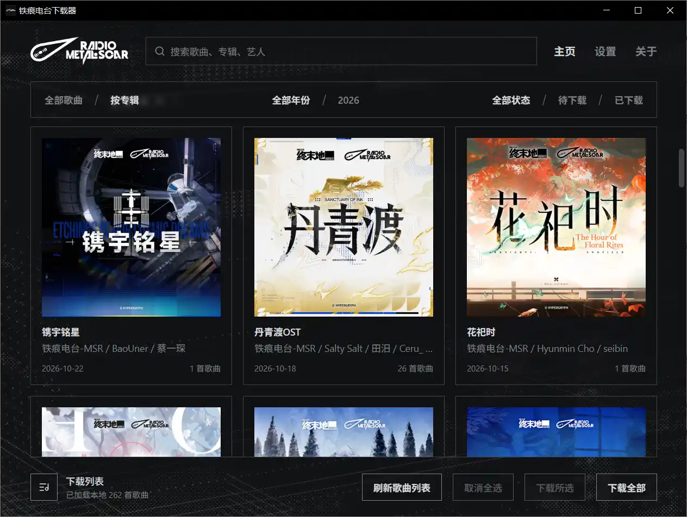
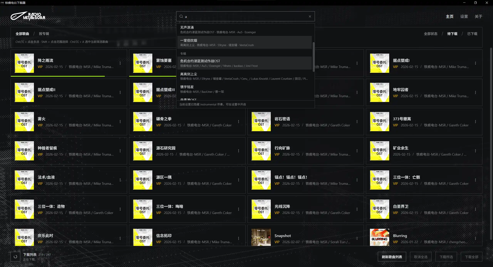
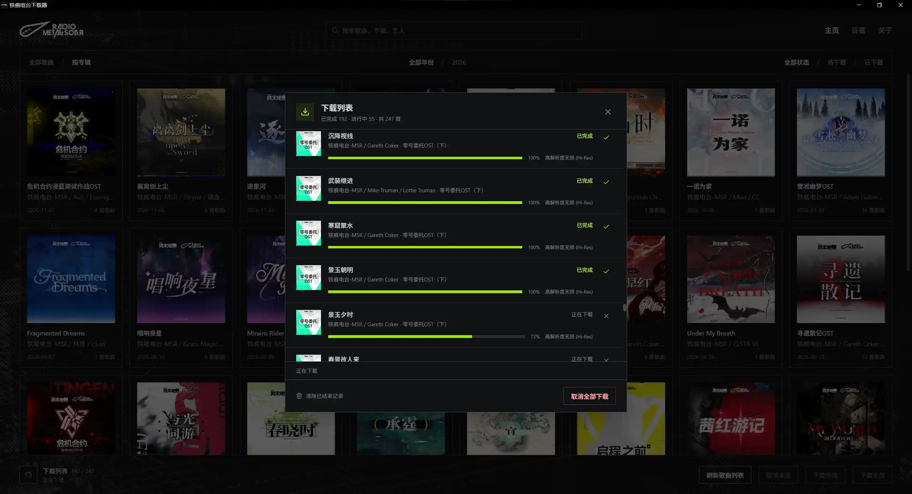

<div align="center">
<h3>鐵痕電台下載器</h3>
<p>從網易雲音樂下載鐵痕電台的音樂專輯，儲存封面、歌詞與歌曲資訊</p>

[简体中文](README.md) · [繁體中文](README.zh-TW.md) · [English](README.en.md) · [日本語](README.ja.md) · [한국어](README.ko.md)


[](https://github.com/wiseCirno/metal-scar-downloader/releases/latest)


</div>

## 特色

- 依歌曲或專輯瀏覽，支援搜尋歌曲、專輯和藝人
- 支援單曲下載、多選下載和增量更新
- 支援下載歌詞、伴奏篩選
- 可自訂期望音質，支援自動降級並顯示每首歌曲實際下載的音質
- 自動寫入歌曲資訊與專輯封面，支援選擇藝人分隔符號、日期格式和專輯目錄格式
- 適合主流自建媒體庫（Emby, Jellyfin, Plex 等）
- 多語言支援

## 安裝

在 [Release](https://github.com/wiseCirno/metal-scar-downloader/releases/latest) 頁面下載最新版本

Windows 可攜版解壓縮後可以直接執行執行檔，但需要 WebView2
執行階段，啟動時若提示缺少元件，可在 [這裡](https://developer.microsoft.com/zh-cn/microsoft-edge/webview2) 下載安裝

macOS 開啟後將應用程式拖入「應用程式」即可。首次開啟若提示開發者未經驗證，可在「系統設定 → 隱私權與安全性」中允許開啟

Linux 提供 x64 AppImage、deb 和 rpm，AppImage 加上執行權限後即可執行，請依自己的發行版自行選擇

## 設定

下載歌曲前，在設定中選擇下載路徑、登入網易雲音樂帳號，並安裝 FFmpeg 工具

Windows 支援一鍵下載安裝 FFmpeg

macOS 需要安裝 [Homebrew](https://brew.sh)，並透過 `brew install ffmpeg` 安裝 FFmpeg 工具

Linux deb 會自動安裝 FFmpeg；RPM 會宣告 FFmpeg 執行檔相依性。AppImage 使用者請透過發行版的套件管理員安裝 FFmpeg

安裝完成後，在程式設定中點選「查看版本」可正確顯示 FFmpeg 版本，即表示安裝成功

最高音質預設為無損，可依帳號權限選擇 高解析度無損、無損、極高或標準；下載時會從所選音質開始逐級嘗試，並儲存實際取得的音質

音訊標籤中的專輯藝人固定為 `铁痕电台-MSR`，多位藝人預設以分號 `;` 分隔，可在設定中選擇適合自己音樂媒體庫的格式

## 使用說明

點選「重新整理歌曲清單」可取得最新曲庫，預設讀取網易雲音樂中的 [鐵痕電台](https://music.163.com/#/artist?id=122546004)

程式支援單曲下載和批次下載，批次下載時會依據「下載伴奏」選項決定是否包含伴奏歌曲

點選歌曲卡片可切換選取狀態；`Ctrl/⌘ + 點選` 可多選，`Shift + 點選` 可選取連續範圍，`Ctrl/⌘ + A`
可選取目前篩選下的所有歌曲。選好後點選「下載所選」，點選「取消全選」可清空選取項目

切換至「依專輯」可查看專輯封面、發行日期與歌曲數量，點選專輯可查看其中的歌曲；年份和下載狀態篩選同樣適用

<div align="center">

</div>

在頂端搜尋框輸入關鍵字，可搜尋歌曲、專輯和藝人。選擇歌曲會捲動定位至對應位置，選擇專輯可查看專輯內容，選擇藝人可篩選其參與的歌曲

<div align="center">

</div>

點選左下角的下載清單圖示，可逐首查看下載進度、處理狀態與實際音質，並取消單首或所有下載工作

下載失敗時，提示中會顯示記錄檔路徑，詳細資訊儲存在下載目錄的 `.metal-scar/logs` 中

<div align="center">

</div>

開啟「下載歌詞」後，會將可用歌詞儲存為與歌曲同名的 LRC 檔案

FLAC、MP3 和 M4A 檔案會寫入歌曲資訊與專輯封面，專輯目錄同時儲存 `cover.jpg`。藝人分隔符號和日期格式設定會在後續下載時生效

## 常見問題

#### 1. 為什麼選擇網易雲

目前網易雲使用者較多，使用網易雲帳號登入是相對容易接受的方式，而且歌詞、封面及歌曲的品質都屬於較佳的水準。
有些人可能會想，Tidal 這樣的平台會不會更好。我認為，除了音質上的些微優勢，其他方面都比較不便：僅支援英文、更新較慢，而且沒有官方歌詞支援。
此外，其他串流媒體平台有嚴格的 DMCA 政策與加密手段，以學習交流用途嘗試下載上面的歌曲並不合適。

#### 2. 為什麼無法下載歌曲

**鐵痕電台目前並沒有官方網站**，而採用網易雲曲庫時，由於鐵痕電台大部分歌曲均為 VIP
歌曲，需要一定的[付費歌曲額度](https://music.163.com/#/member/downinfo)才能下載，因此帳號需要擁有對應權益

#### 3. 無法下載 FFmpeg

Windows 可從 [官方網站](https://ffmpeg.org/download.html) 手動下載 FFmpeg，將 `ffmpeg.exe` 複製到
`%APPDATA%\com.wisecirno.metal-scar-downloader\bin` 目錄下，再點選「查看版本」確認安裝結果

macOS 可透過 `brew install ffmpeg` 安裝，下載速度較慢時可調整網路環境後重試

#### 4. 如何定義歌曲的「已下載」狀態

歌曲下載成功後，會將「已下載」狀態儲存到應用程式資料目錄中

歌曲檔案移動或刪除後，程式仍保留下載狀態，方便將音樂轉移至其他裝置，並繼續增量更新

需要重新下載時，可在歌曲卡片選單中將其標記為待下載，也可在設定中批次修改下載狀態

#### 5. 如何讓媒體庫區分多位藝人

在設定中選擇「藝人分隔符號」，預設使用分號，例如 `藝人A;藝人B`。可依自己的音樂媒體庫選擇 `;`、`\`、`,`、`、`或 `&`。
Emby, Jellyfin 就只辨識 `;` 分隔，所以預設選項就是這個了

修改後重新下載對應歌曲，即可更新檔案中的音訊標籤

## 後續計畫

- 等待官方網站，這樣就能與塞壬唱片的實作方式對齊
- 增添一些實用功能，讓開發者再掉一把頭髮，可能就有靈感了（

## 致謝

### 唱片提供者

[鐵痕電台-MSR](https://music.163.com/#/artist?id=122546004)

### 核心專案參考

[nuthx/siren-downloader](https://github.com/nuthx/siren-downloader)

[NeteaseCloudMusicApiEnhanced](https://github.com/NeteaseCloudMusicApiEnhanced/api-enhanced)

### 基礎框架

[FFmpeg](https://ffmpeg.org/)

[Tauri](https://tauri.app/)

## 免責聲明

本工具僅供學習與技術交流使用，所有音樂版權均歸原作者及相關版權方所有，任何下載內容均不得用於商業用途。

本工具中使用的鐵痕電台及相關 LOGO 均為其合法擁有者的註冊商標或版權標識，僅用於識別用途，歸相關版權方所有

<details>
<summary>開發與建置</summary>

以 Tauri 2、Rust 和 React 為基礎。桌面版建置需要 Rust、[Tauri 系統相依套件](https://v2.tauri.app/start/prerequisites/)
和目標平台工具鏈

```sh
pnpm install --frozen-lockfile
pnpm run build
cargo test --manifest-path src/Cargo.toml --lib
pnpm exec tauri build --config src/tauri.conf.json
```

首次建置會準備固定版本的 Node.js 執行階段和網易雲音樂 API 正式環境相依套件，並依 Node.js 官方 SHA-256
清單驗證執行階段。執行資源隨桌面應用程式封裝，首次使用時解壓縮至應用程式資料目錄，之後依版本重複使用

升級網易雲音樂 API 相依套件時，更新獨立清單和鎖定檔：

```sh
npm install --prefix runtime/netease-api --save-exact @neteasecloudmusicapienhanced/api@<version> --ignore-scripts
```

之後執行 `pnpm run build` 或 `pnpm dev`，即可依新版本準備執行資源

### 自動建置與發行

提交至 `main`、向 `main` 發起 PR，或在 Actions 頁面手動執行 Build，都會產生 Windows x64、macOS Apple Silicon 和 Linux
x64（AppImage、deb、rpm）安裝套件。測試套件可在對應 Actions 執行頁面的 Artifacts 中下載

正式發行時，先統一 `package.json`、`src/Cargo.toml` 和 `src/Cargo.lock` 中本應用程式的版本，再推送對應標籤，例如目前版本使用
`v0.1.1`。標籤必須與應用程式版本一致；所有平台建置及檢查通過後，會自動建立 GitHub Release 並上傳安裝套件和統一的
`SHA256SUMS.txt` 檢查碼檔案

```sh
git tag v0.1.1
git push origin v0.1.1
```

建置指令碼與 `runtime/netease-api` 中的相依套件清單、鎖定檔均需提交至 Git，產生的相依套件和執行資源由 CI 自動準備

</details>
